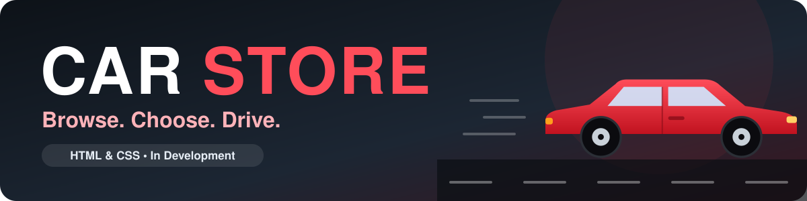

<div align="center">



# 🚗 Car Store 🏁

### A car store website built with HTML and CSS

*A front-end project focused on creating an attractive, clean and easy-to-navigate car store website.*


🚘 🏎️ 🚙 🛣️ 🔑

</div>

---

## 📖 About the Project

**Car Store** is a website for a car store, built using **only HTML and CSS**. The project is a way for me to practice front-end development, page structure, styling and layout design while creating something real.

> 🚧 **Status:** This project is still **under development**. Pages, sections and design improvements are being added as I continue working on it.

---

## 🛠️ Technologies Used

| Technology | Purpose |
|:----------:|:--------|
| 🟧 **HTML5** | For structuring the website |
| 🟦 **CSS3** | For styling and layout design |

> 💡 This project uses **HTML and CSS only**. No JavaScript is used.

---

## 🚧 Project Status

**Currently in Development**

Car Store is an ongoing project, and more content and improvements will be added over time.

- [x] Start the project with HTML and CSS
- [ ] Finish the main pages
- [ ] Add more cars and car information
- [ ] Improve the design and responsiveness

---

## 🚀 Getting Started

To view the website locally:

**1.** Clone the repository:

```bash
git clone YOUR_REPOSITORY_URL
```

**2.** Open the project folder.

**3.** Open `index.html` in your web browser. 🚗

No installation or build tools needed. Just a browser!

---

## 📂 Project Structure

<!-- Adjust this structure to match your real project files. -->

```
car-store/
├── index.html
├── style.css
└── README.md
```

---

## 🎯 Project Goal

To improve my skills in **HTML** and **CSS** by designing and building a complete, good-looking car store website.

---

## 👨‍💻 Author

**KUBWIMANA Florent**

[](https://github.com/Florent-20)
[](https://webnety.netlify.app/)

---

<div align="center">

*Made with 🚗 and a lot of curiosity.*

⭐ If you like this project, give it a star!

</div>
